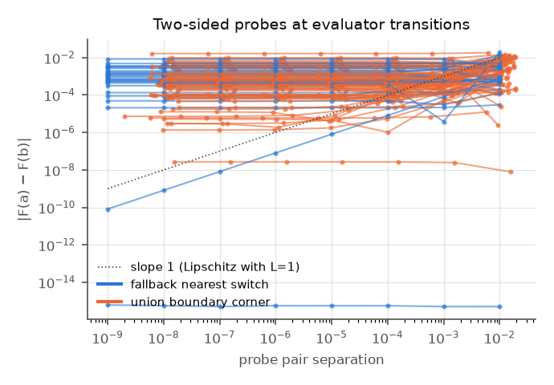
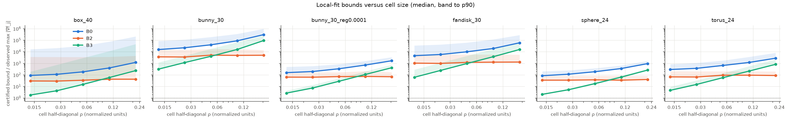
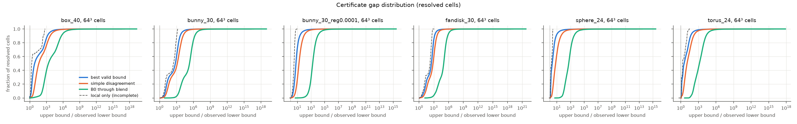
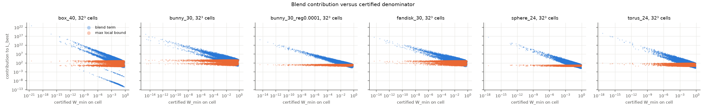
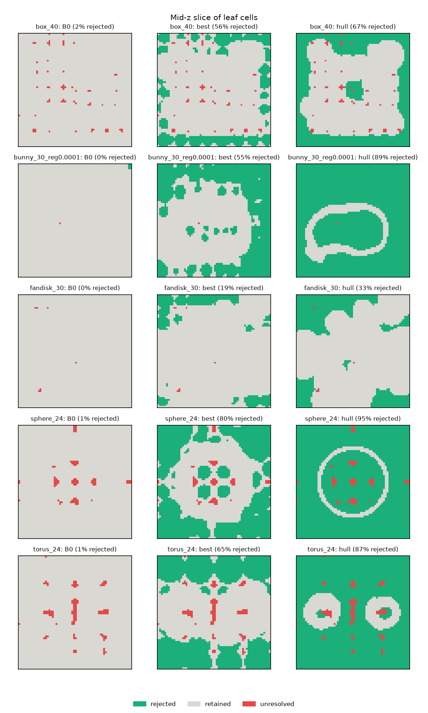

# Lipschitz bounds for the RBF Your SDF reconstruction: report

Experiment defined in `Lipschitz Bound Experiment for RBF Your SDF.md` (repository root).
Code, conventions and how to reproduce: [`README.md`](README.md). Every number below
comes from a saved run under `demo/additional_experiments/results/lipschitz/`. The full
tables are in [`report/report_tables.md`](report/report_tables.md), generated by
`report.py`. Unfinished runs and studies are tracked in issue #13.

**Setup.** The baseline is the current implementation (base commit `fd785de`) with
Python defaults:
- PU with sphere partition, overlap 0.2;
- cubic Duchon local fits with `reg=0`, `pu_dedup_tol=5e-4`;
- 10 outer iterations.

Fits are frozen as hashed snapshots, and all bounds use the snapshot's numbers as exact
reals in the fit's normalized frame. Gradients and Lipschitz constants are the same in
the physical frame, so all bounds are dimensionless. The query domain is the sample
bounding box. One extrapolation run uses a box expanded by 10% per side, and its
statistics are reported separately.

**Inputs.**
- Analytic exact SDFs (sphere, box, torus, thin shell) on 12³, 24³ and 40³ grids.
- Meshes through the repository's sampling driver: bunny and fandisk at 30³.
- Three bunny fit variants, each a separate field with its own hash: `reg=1e-6`,
  `reg=1e-4`, `pu_dedup_tol=5e-3`.

## Summary

1. **Validity holds everywhere it was tested.**
   - **Grid certificates:** about 5.7M grid cells across 18 runs, with 0 cases where a
     certified bound fell below an observed or locally optimized gradient norm.
   - **Pruning:** 491k sign-changing lattice-edge checks and interior probes across 15
     pruning runs, with 0 rejected cells that contain a zero.
   - **Witnesses:** 97 of 99 numerically found discontinuity candidates were proven
     analytically; the other 2 are probes where the field is continuous.

2. **The baseline field has no finite Lipschitz constant on its domain.**
   - **Jumps:** it jumps across nearest-patch switches in uncovered gaps and at corners
     of the union of supports.
   - **Sizes:** certified jump lower bounds run from 1e-8 to 2.8e-2. They were found
     inside the sample box in 15 of 18 runs.
   - **Where it applies:** a constant can only be certified per box, away from these
     interfaces. Such boxes are 98–100% of cells at 64³ on the sample box, but only 79%
     on the 10%-expanded domain.

3. **Cancellation plus subdivision does produce much tighter bounds than the triangle
   bound B0, but only the cell-local Taylor bound B3 converges.**
   - **Local fits:** B0 / observed stays at 40–15,000 (median) on 64³ cells. B3 / observed
     falls about 4× per halving of the cell and reaches 1.5–5 on well-conditioned fits.
   - **Full field:** L_best / observed is 1.1–1.9 on 128³ cells for spheres, tori and
     `reg=1e-4`.
   - **The moment bound B2 never beats B1 by more than rounding.** The stored moment
     residuals are about 1e-11 to 1e-7, so they are not the limitation. The cost is
     Σ|α| times the spread of the centers.

4. **The limiting factor is local coefficient magnitude Σ|α|,** caused by clustered,
   nearly duplicate tangent-point constraints solved without regularization (#10). This
   single quantity orders tightness and rejection across all runs: median Σ|α| ranges
   from about 760 (sphere 12³) to 5e5 (bunny 30³).

5. **Practical pruning works, with the convex-hull sign test, not with a Lipschitz
   bound.**
   - **What the hull test is:** on a box with W > 0 everywhere, F is a convex combination
     of the contributing local fits. If every one of them has a certified strict sign on
     the box, F has no zero there.
   - **How well it rejects:** 85–96% of 64³ leaves on spheres and tori, 33–67% on
     box/bunny/fandisk at the baseline settings.
   - **Lipschitz rejection** (`d₀ > Lρ`) with the best bound removes 15–94%, and with B0
     essentially nothing.
   - **Runtime:** with the C++ certifier (#8), certified pruning beats the unpruned query
     in wall time on well-conditioned fits: 3.8× at 64³ leaves on sphere 12³, measured
     under load. With the Python reference certifier it never does.

## 1. Validity

**What is certified.**
- Analytic field: every `*_cert` function in `bounds.py` and everything returned by
  `PUCertifier.certify` (Python) or `PUInterpolator.certify_boxes` (C++).
- Numerical enclosure:
  - outward rounding of each operation, using `nextafter`;
  - for sums over centers, Higham's a priori bound γ_{n+k}·Σ|terms|;
  - the C++ file is compiled with `-ffp-contract=off -fno-fast-math`.
- Enclosed quantities: distance extrema, coefficient sums, moment residuals, value,
  gradient, Hessian, norms, `W_min`, weight-gradient bounds, center values and the final
  bound.
- The two certifiers agree exactly on statuses and decisions (unit test
  `TestNativeCertifier`).

**Evaluator audit** (issue #1):
- **Native gradient.** It differentiates the full blend, weight derivatives included.
  Central differences agree to about 1e-10 relative at h = 1e-5.
- **Reference vs native.** The independent Python evaluator matches the native one to:
  - values: 4e-15 (sphere) to 1.2e-11 (bunny);
  - gradients: 3e-13 to 5e-9.

  The error scales with Σ|α|.
- **One evaluator-accuracy finding.** Near a support boundary with a single active
  patch, the native gradient formula (G + A − F·B)/W cancels catastrophically, giving a
  relative error of order ε/(1 − t). The analytic field is smooth there.

**Statuses.** Boxes with certified `W_min > 0` are `certified`. A box that misses every
support and has a provably unique nearest support is `fallback_fixed`. Every other box is
`unresolved` and gets no finite bound. On the sample box, unresolved cells are:
- 0–1.6% at 64³;
- 0–0.4% at 128³;

They concentrate in interior coverage gaps; see the red cells in
[`report/prune_slices.png`](report/prune_slices.png). On the expanded domain they are 21%
at 64³.

**Discontinuities** (issue #6, `witness.py`). Two transition types are proven from
interval enclosures of the stored fits:
- **Nearest-patch switch in a gap.** Both one-sided limits are local fits, and their
  enclosed difference excludes zero.
- **Union-boundary corner.** A point lies on two support spheres and outside all others.
  Approach directions entering both supports give limits
  (λ f_j + f_k)/(λ + 1) with different λ = ((n_j·u/R_j)/(n_k·u/R_k))⁴.

## 2. Tightness

Ratios are certified upper bounds over observed lower bounds: the maximum gradient norm
on a 3³ lattice per closed cell from the verified native evaluator, improved by local
L-BFGS-B maximization on 60 cells per grid. The optimizer increased the lattice maximum
by under 4%. The ratio is an observed certificate gap, not the true overestimation.

**Local fits** (40 random patches per run, boxes meeting their support):

- **B0 decays slowly with cell size.** It is the reference bound for "summing magnitudes".
- **B1 = B2 is flat in cell size.** It removes the query distance but pays Σ|α_i|·|q_i − c|².
- **B3 converges quadratically,** to 1.5–5 at ρ ≈ 0.0135 on well-conditioned fits. It is
  still 60–300× at that size on the ill-conditioned baselines.
- **B1 was never violated on stored coefficients.** Its exact-moment premise is false at
  the 1e-11 to 1e-7 level, so it remains uncertified.

**Full field** (median L_best / observed on 64³ cells; see the tables for p90/p99/max):

| run | median Σ\|α\| | L_best / obs | B0 through blend / obs | local only / obs (incomplete) |
|---|---|---|---|---|
| sphere 12³ | 764 | 1.63 | 670 | 1.51 |
| sphere 24³ | 1.8e3 | 2.12 | 539 | 1.69 |
| torus 24³ | 6.8e3 | 3.62 | 1.5e3 | 2.01 |
| shell 24³ | 3.5e4 | 22.7 | 9.3e3 | 14.7 |
| box 40³ | 1.1e3 | 7.43 | 2.3e3 | 2.17 |
| bunny 30³, reg 1e-4 | 2.6e3 | 6.23 | 1.7e3 | 3.2 |
| bunny 30³, reg 1e-6 | 2.8e4 | 47.8 | 1.6e4 | 21.8 |
| bunny 30³, dedup 5e-3 | 8.4e4 | 113 | 3.7e4 | 60.7 |
| fandisk 30³ | 2.4e5 | 317 | 1.0e5 | 171 |
| bunny 30³ (baseline) | 5.1e5 | 635 | 2.1e5 | 298 |

- **The blend term matters.** Leaving it out ("local only") falls below the observed
  gradient on many cells; it is not an upper bound, as the different-constant-patches
  test shows. At 64³ the blend term is a median 7–60% of L_best, and it dominates where
  W_min is small. The heavy upper tails (p99 up to 1e16 or more) are cells grazed by
  several support boundaries at once.
- **Disagreement refinement helps by a factor of 2–7 over the simple Δ bound.** That is
  the Taylor bound on the merged difference fit, which cancels coefficients at shared
  centers.
- **The direct interval quotient is a weaker independent bound.** It wins in up to 18%
  of cells.

## 3. Utility: conservative cell rejection

**Setup.** Each octree (root 4³, depth 4, so 64³ leaves) is traversed once per rule,
reusing cached certificates:
- `B0`: B0 through the full blend bound;
- `best`: the valid minimum, with disagreement refinement and subdivision;
- `hull`: the convex-hull sign test;
- `best_hull`: either `best` or `hull`.

**Rejection rate** (fraction of 64³ leaves rejected):

| run | B0 | best | hull |
|---|---|---|---|
| sphere 12³ / 24³ / 40³ | 0 / 0.5% / 0.4% | 94 / 80 / 73% | 96 / 95 / 93% |
| torus 12³ / 24³ / 40³ | 0 / 0.6% / 1% | 83 / 66 / 64% | 94 / 87 / 85% |
| box 12³ / 24³ / 40³ | 0 / 0 / 2% | 0.2 / 32 / 56% | 18 / 44 / 67% |
| shell 24³ | 0.5% | 46% | 63% |
| bunny 30³, reg 1e-4 | 0.2% | 55% | 89% |
| bunny 30³, reg 1e-6 | 0.04% | 22% | 53% |
| bunny 30³, dedup 5e-3 | 0 | 18% | 36% |
| fandisk 30³ | 0.06% | 19% | 33% |
| bunny 30³, expanded domain | 0 | 16% | 35% (21% unresolved) |

`best_hull` adds almost nothing over `hull`, so the Lipschitz route is dominated.
Rejection at coarse octree levels requires Σ|α|·ρ³ to be small compared with |F|.
Ill-conditioned fits therefore reject only near the leaves.

**Cost.**
- **Implementation-neutral break-even** (most a bound kernel term may cost, relative to a
  field kernel term, for pruning to save work): up to 4.1 (sphere 12³, hull) and 1.5–2.1
  on the other spheres and torus 12³. It is below 0.3 for every baseline mesh-like fit.
- **Python certifier:** about 40× slower per kernel term than the native evaluator, so
  every pruned query was slower than unpruned (e.g. sphere 24³: 200 s vs 11 s).
- **C++ certifier (#8):** about 200× faster than the Python one, and as fast per term as
  native evaluation. Measured under load from the suite: shell 24³ at 64³ leaves, 10.2 s
  vs 11.9 s unpruned with the hull test. Sphere 12³ at 32³ / 64³ leaves: 1.6× / 3.8×
  faster with hull, 0.9× / 2.0× with best.

The gain grows with leaf resolution: the unpruned query scales like N³, while the
certified shell of boxes scales roughly like N² across levels. Idle-machine timings at
128³–512³ (the sparse marching cubes use case) are in #13.

The guarantee is only that pruning discards no zero of the analytic field. A component
lying entirely inside a retained leaf is not guaranteed to produce a corner sign change.

## Conclusions and recommendations

- **Use the hull test, not a Lipschitz bound, for pruning** (`certify_boxes`, C++).
  - It needs only per-patch value ranges.
  - It is never weaker than `best` by more than a few percent of cells.
  - It is the only rule whose break-even cost is within reach.
- **A global Lipschitz constant for the baseline field does not exist** on its domain
  (certified jumps). Per-box constants are valid and, for well-conditioned fits, tight at
  fine cells.
- **Fixing the fit's conditioning is the main lever:** tangent-point cluster merging,
  scale-free dedup (#10), and better tangent-point convergence (#11).
  - `reg=1e-4` cuts Σ|α| 200× and lifts hull rejection on the bunny from 35% to 89%.
  - The price: the surface moves (median |F| on the true surface goes from 2.1e-4 to
    7.2e-4) and exact interpolation is lost.
  - A conditioning fix that keeps interpolation should give most of the benefit.
- **Coverage repair** (expanded or added supports) is not justified on the sample box:
  unresolved cells are ≤1.6% at 64³. It would matter for extrapolation (21% unresolved on
  the expanded domain).
